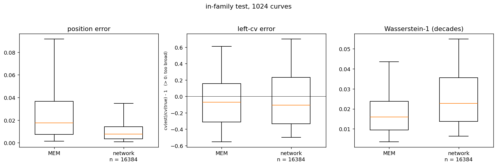
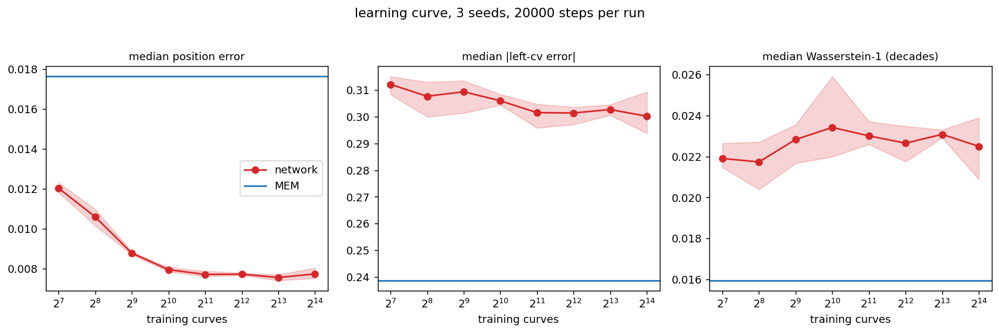
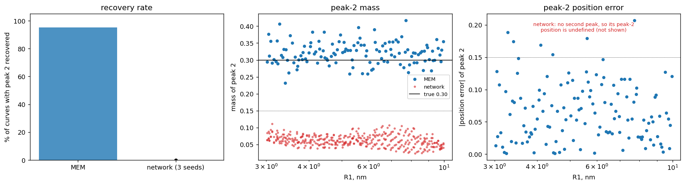
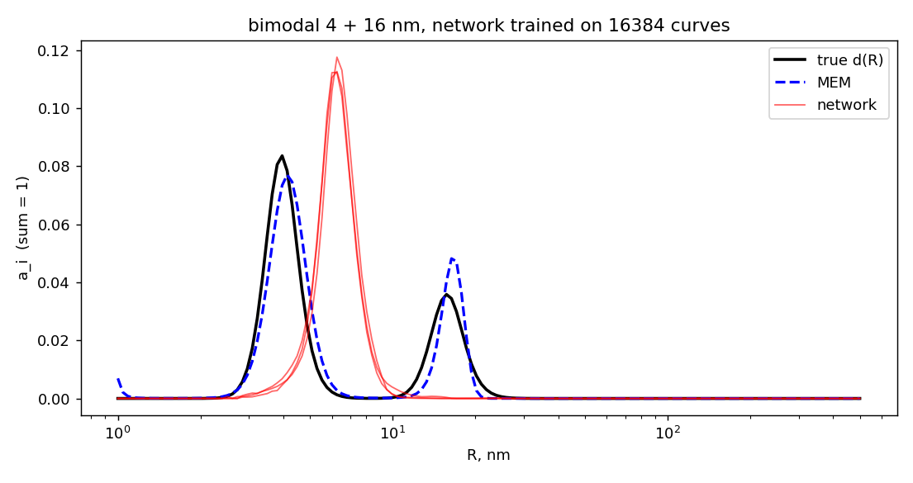

# Out-of-distribution robustness of neural networks for inverse problems

A PyTorch benchmark against a constrained maximum-entropy solver, on synthetic light-scattering data with known ground truth.

**In plain words.** Dynamic light scattering (DLS) measures how fast particles in a liquid move and, from that, recovers their size distribution. Turning the measurement into a size distribution is an ill-posed inverse problem: many different distributions fit the same data. This project builds a benchmark for it. A PyTorch network and a constrained maximum-entropy solver (MEM, https://github.com/heliosight/GFBR-MEM-inversion) receive the same synthetic measurements and are scored against the known true answer. Both are then tested on a type of distribution the network has never seen.

## What was built

- A synthetic data generator: a Sobol-sampled library of 16,384 training curves, plus validation, in-distribution test and out-of-distribution test sets, each curve with its own stored noise realization.
- A constrained MEM solver (IPOPT through CasADi) with an exact feasibility boundary for every curve, run in parallel over the test sets.
- A PyTorch network (two ReLU layers, softmax output) with a learning curve: 8 training sizes from 128 to 16,384 curves, 3 seeds each, fixed gradient-step budget, best-validation checkpoint.
- An evaluation harness: peak position, peak width and Wasserstein-1 distance against the truth, with cached results.
- A physics-informed loss variant, tested against the plain MSE loss.

## Findings

- **In distribution**, the two methods are within a few percent of the truth. The network is more accurate on peak position; MEM is somewhat more accurate on peak width and overall shape.
- **Out of distribution** (bimodal distributions, never seen in training), the network recovers the second peak in 0% of 128 cases and MEM in 95%.
- **More training data** (128 to 16,384 curves) and a **physics-informed loss** did not close the gap.

## Setting

A network for this problem has to be trained on simulated curves, because measured correlation functions with known size distributions are not available as a dataset. This benchmark uses the setting most favourable to the network: training and testing come from the same simulation, with white Gaussian noise and intensity-weighted distributions, and no scattering model or instrument response. A more realistic simulation would need a physical model of the correlation function, the instrument response, and calibration against standards of known size.

## Setup

- **Forward model.** `g1(tau) = sum_j a_j exp(-Gamma_j tau)`, with `Gamma = D q^2` (Stokes-Einstein, 173 deg, 633 nm, water at 23 C). 150 log-spaced radius bins from 1 to 500 nm, 100 log-spaced lag times from 0.1 us to 0.1 s.
- **Noise.** Gaussian, white, `sigma = 0.006`, one realization per curve, added once.
- **Trim.** The same for every curve and every method: keep the points down to g1 = 0.05, drop the points between 0.05 and 1e-4, and set the rest to exactly 0. The network reads the length-100 vector. MEM uses the kept points plus 13 zero points.
- **Peak shape.** Exponentially modified Gaussian (skewed to larger R), parameterised by mean radius `R0` and relative width cv.
- **Training family.** Unimodal, `R0` from 3 to 300 nm, cv from 0.08 to 0.30. 16,384 training curves, 1,024 validation, 1,024 test (in distribution).
- **Out-of-distribution test.** Bimodal, `R2 = 4 R1`, `R1` from 3 to 10 nm, cv 15%, intensity weights 70/30. 128 distributions, never used in training or validation.
- **Constrained MEM.** Maximize the entropy subject to `sum(a) = 1`, `a >= 0` and `||K a - g1||^2 <= C`, with `C` set just above the feasibility boundary, `C = 1.005 Cb`. `Cb` is computed exactly for each curve. All 1,152 solves converged.
- **Network.** Two ReLU hidden layers of 128, softmax output, MSE against the true distribution, 20,000 steps, cosine learning rate, best-validation checkpoint.
- **Metrics, against the truth.** Peak position error (interpolated), error of the left-side cv, and the Wasserstein-1 distance in decades of R (0.01 is a size shift of 2.3%).

## Results

### In distribution (1,024 test curves)

| median | MEM | network (16,384 curves) |
|---|---|---|
| peak position error | 1.8% | 0.8% |
| left-cv error (signed) | -7% | -11% |
| median abs left-cv error | 0.24 | 0.30 |
| Wasserstein-1 | 0.016 (3.7% in size) | 0.023 (5.4% in size) |

Both position errors are below one grid bin (4.25%). The network's left-cv is undefined on 26 of 1,024 curves, MEM's on none.

The network's error stays flat as the training set grows: the position error levels off at about 1,000 curves, and the width and Wasserstein-1 errors are flat from 128 to 16,384.

### Out of distribution (128 bimodal distributions)

| median | MEM | network (3 seeds) |
|---|---|---|
| mass of the second peak (true 0.30) | 0.32 | 0.05 to 0.07 |
| position error of peak 1 | 4% | 53 to 57% |
| Wasserstein-1 | 0.032 | 0.21 |
| second peak recovered* | 95% | 0% |

*mass above 0.15 and position within 15% of the truth.

In all three seeds the network output is a single peak between the two true peaks.

### Physics-informed loss

Adding the g1 residual `(K a - g)^2` on the rows MEM uses to the MSE loss (`gfbr_nn_pinn.ipynb`) raised the validation MSE against the truth: 5.8e-5 without it, 1.9e-4 with weight 1 and 5.5e-4 with weight 10 (one seed). It is kept for reference and is not part of the comparison.

## Files

Run in this order:

1. `gfbr_data.ipynb`: generates the library `gfbr_data.npz` (about 45 MB, regenerated by the notebook).
2. `gfbr_mem.ipynb`: the constrained MEM solver on single curves, with the trim and the feasibility boundary explained.
3. `gfbr_nn_naive.ipynb`: the baseline network on single curves.
4. `gfbr_nn_evaluation.ipynb`: the full comparison and all figures. MEM runs in parallel and takes about 35 minutes for the test set; results are cached after the first run.
5. `gfbr_nn_pinn.ipynb`: the physics-informed loss variant.

`gfbr_mem_lib.py` is the MEM solver used by the evaluation notebook.

Requirements: Python 3, numpy, scipy, matplotlib, torch, casadi (with IPOPT), jupyter.
